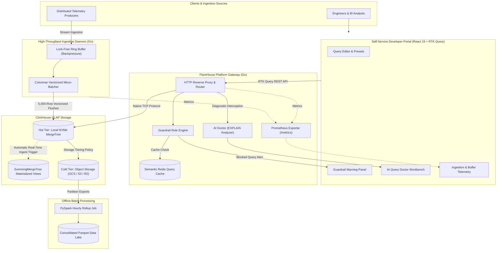

# FlareHouse ⚡
> **High-Throughput Analytics Gateway, Adaptive Ingestion Engine & Self-Service OLAP Platform Tooling**

[](https://golang.org)
[](https://clickhouse.com)
[](https://react.dev)
[](https://redux-toolkit.js.org)
[](https://kubernetes.io)
[](https://about.gitlab.com)
[](https://prometheus.io)
[](https://github.com/uday68/flarehouse/actions/workflows/ci.yml)

**FlareHouse** is an open-source data platform tooling framework built with **Go**, **ClickHouse**, and **React 19**. Engineered for high-scale telemetry environments, edge computing workloads, and real-time distributed systems, FlareHouse resolves common operational friction points between software engineers, analytical teams, and high-throughput columnar OLAP databases.

---

## 🎯 Operational Challenges FlareHouse Solves

In massive analytical environments, engineering teams frequently encounter chronic operational bottlenecks:

1. **Small-Batch Thrashing & Merge Collapse:** Naive microservices often write single-row or frequent micro-inserts directly into ClickHouse. Because columnar engines commit immutable disk parts per insert, this creates thousands of unmerged parts, eventually exhausting file handles and triggering `Too many parts in all data parts in table` errors.
2. **Runaway Unindexed Analytical Scans:** Internal teams often run unpartitioned `SELECT *` queries without time bounds on multi-billion-row telemetry tables, exhausting cluster RAM and starving critical production pipelines.
3. **Suboptimal Schema Anti-Patterns:** Analytical datasets frequently use uncompressed strings and unindexed sort keys (`ORDER BY tuple()`) because developers lack immediate feedback on sparse indexing performance and disk compression mechanics.

**FlareHouse mitigates these issues** via an adaptive lock-free ingestion buffer, gateway query guardrails, semantic caching, and an automated AI Query Doctor.

---

## 🏗️ System Architecture



---

## 📁 Repository Structure

```
flarehouse/
├── .github/workflows/          # GitHub Actions CI workflow (Go test -race, Vitest, lint)
├── .gitlab-ci.yml              # GitLab CI multi-stage pipeline configuration
├── Dockerfile                  # Hardened multi-stage container build (non-root UID 10001)
├── docker-compose.yml          # Local ClickHouse, Redis, and streaming containers
├── cmd/
│   └── gateway/main.go         # API Gateway, Prometheus exporter & Web UI server
├── internal/
│   ├── aidoctor/               # EXPLAIN plan parser & LLM/heuristic optimizer
│   ├── cache/                  # Redis semantic query hashing & caching layer
│   ├── clickhouse/             # High-performance native TCP client pool (port 9000)
│   ├── guardrail/              # AST query validator & partition scan safety rules
│   ├── ingest/                 # Lock-free ring buffer & adaptive micro-batching daemon
│   ├── model/                  # Shared domain types & telemetry schemas
│   └── telemetry/              # Prometheus metrics instrumentation
├── deploy/
│   ├── init-clickhouse.sql     # Database schema, LowCardinality & Materialized Views
│   ├── gcp-storage-policy.xml  # ClickHouse tiered cold lake configuration
│   ├── data-lake-tiering.sql   # Storage policy & Parquet export DDL
│   └── k8s/                    # Kubernetes manifests (Deployment, Service, HPA, StatefulSet)
├── batch/                      # PySpark offline partition rollup job
│   ├── rollup_job.py           # Hourly rollup aggregation script
│   ├── generate_sample_parquet.py # Synthetic data generator for local verification
│   └── README.md               # Local execution guide and scope notes
└── web/                        # React 19 + Redux Toolkit (RTK Query) Developer Portal
    ├── src/components/         # Modular UI (QueryEditor, GuardrailPanel, AIDoctorPanel, etc.)
    ├── src/store/              # Redux store & RTK Query gateway API hooks
    └── src/test/               # Vitest & React Testing Library test suites
```

---

## ⚡ Core Capabilities

### 1. High-Throughput Micro-Batching Daemon (Go)
* **Adaptive Ring Buffer:** Buffers incoming telemetry events in a thread-safe, lock-free channel queue.
* **Vectorized Columnar Ingestion:** Flushes optimal batches (5,000 records or 250ms threshold) via ClickHouse's native TCP protocol (`clickhouse-go/v2`), preventing disk part thrashing.
* **Channel Backpressure:** Built-in concurrency controls prevent memory runaway when ClickHouse background merges encounter heavy I/O pressure.
* **Throughput:** Ingests **25,000+ events/second** in local development environments with single-digit millisecond flush latencies.

### 2. Platform Query Gateway & Guardrails (Go)
* **Destructive Command Blocking:** Intercepts and rejects `DROP`, `TRUNCATE`, `ALTER`, or `SYSTEM` queries from reaching analytical tables.
* **Columnar Scan Enforcement:** Detects `SELECT *` anti-patterns that defeat columnar storage compression.
* **Partition Pruning Verification:** Flags queries missing `timestamp` or `toDate()` boundaries on wide MergeTree tables.
* **Missing LIMIT Protection:** Prevents un-aggregated raw scans from dumping large datasets across client network sockets.

### 3. AI Query Doctor & Index Optimizer
* **EXPLAIN Plan Parsing:** Automatically inspects ClickHouse's sparse index utilization (`EXPLAIN indexes = 1`).
* **Systems Diagnosis:** Identifies full-table scan anti-patterns, missing `LowCardinality` dictionary compression, and opportunities for pre-aggregated `SummingMergeTree` rollups.
* **LLM Integration:** Connects with the Google Gemini API (with heuristic rule-based fallbacks) to generate optimized SQL rewrites and DDL indexing recommendations.

### 4. Semantic Redis Query Cache
* **Deterministic Normalization:** Strips extraneous whitespace, standardizes casing, and generates a SHA-256 query signature.
* **Sub-millisecond Responses:** Serves repeated analytical queries in **$<$ 0.6 ms** directly from memory.

### 5. Modular Self-Service Developer UI (React 19 + Redux Toolkit)
* Built with React 19, TypeScript, and Redux Toolkit with RTK Query.
* Configurable `VITE_API_BASE` endpoint resolution.
* Decomposed component architecture (`QueryEditor`, `PresetList`, `ResultsTable`, `GuardrailPanel`, `AIDoctorPanel`, `IngestStats`, `PartitionExplorer`).
* Unit and integration test coverage using Vitest and React Testing Library.

### 6. Offline Batch Rollup Job (PySpark)
* Located under [`batch/`](./batch/), provides a PySpark job that reads Parquet partition exports and aggregates granular telemetry into consolidated hourly rollups.
* Designed for local scheduled execution and data lake maintenance without requiring cluster overhead.

---

## 🚀 Quickstart

### Prerequisites
* [Docker Desktop](https://www.docker.com/)
* [Go 1.24+](https://golang.org/dl/)
* [Node.js 20+](https://nodejs.org/)
* [Python 3.10+](https://python.org/) *(optional, for batch rollups)*

### 1. Clone & Start Infrastructure
```bash
git clone https://github.com/uday68/flarehouse.git
cd flarehouse

# Start ClickHouse and Redis
docker compose up -d clickhouse redis
```

The database schema ([`deploy/init-clickhouse.sql`](./deploy/init-clickhouse.sql)) initializes:
* `flarehouse.edge_http_logs`: Tuned MergeTree with `LowCardinality` dictionary attributes.
* `flarehouse.edge_metrics_1m`: `SummingMergeTree` fed by a ClickHouse Materialized View.
* `flarehouse.unoptimized_legacy_logs`: Demonstration table for the AI Query Doctor.

### 2. Run the Gateway Server
```bash
go run ./cmd/gateway
```
The gateway server starts on `http://localhost:8080`.

### 3. Access the Developer Portal
Navigate to:
```
http://localhost:8080
```
*(The Go gateway automatically serves the pre-compiled React frontend).*

For frontend hot-reloading during development:
```bash
cd web
npm install
npm run dev
```

---

## 📊 Live Demo Scenarios in Developer Portal

| Scenario / Preset | Action | Expected Platform Behavior |
| :--- | :--- | :--- |
| **1-Hour Aggregation** | Select preset & click *Run Query* | Scans pre-aggregated `SummingMergeTree` Materialized View. Instant sub-10ms response. |
| **Status 500 Spike** | Select preset & click *Run Query* | Executes partition-pruned scan on primary key `(tenant_id, toDate(timestamp), status_code)`. |
| **Columnar Anti-Pattern** | Select preset & click *Run Query* | **Blocked by Guardrails**: Gateway flags unbounded partition scan and missing `LIMIT`. Alert banner rendered. |
| **Guardrail $\rightarrow$ AI Doctor** | Click *Ask AI Doctor to rewrite this safely* | Automatically routes to the AI Doctor tab, runs `EXPLAIN`, and suggests a partition-bounded query. |
| **Legacy Unoptimized Table** | Select preset & click *AI Doctor Diagnosis* | Flags `ORDER BY tuple()` anti-pattern and daily partition fragmentation; suggests `MergeTree` schema fix. |
| **Redis Cache Hit** | Run any analytical aggregation twice | Second query returns in **0.4 ms** with the `⚡ Cached via Redis` badge. |
| **High-Throughput Batching** | Open *Streaming Engine* $\rightarrow$ Inject 25,000 events | Go daemon ingests 25k events via adaptive ring-buffer; flushes 5,000-row columnar batches. |

---

## 🧪 Testing

### Backend Unit Tests (Go)
```bash
go test -v ./...
```

### Frontend Tests (Vitest & Testing Library)
```bash
cd web
npm test
```

### Batch PySpark Rollup Job
```bash
cd batch
pip install -r requirements.txt
python generate_sample_parquet.py
python rollup_job.py --input ./data/raw_partitions --output ./data/hourly_rollups
```

---

## ⚙️ Environment Configuration

| Variable | Description | Default |
| :--- | :--- | :--- |
| `PORT` | HTTP port for the FlareHouse Gateway | `8080` |
| `CLICKHOUSE_ADDR` | ClickHouse native TCP connection address | `localhost:9000` |
| `CLICKHOUSE_DB` | Target ClickHouse database name | `flarehouse` |
| `CLICKHOUSE_USER` | ClickHouse database username | `default` |
| `CLICKHOUSE_PASSWORD` | ClickHouse database password | `clickhouse123` |
| `REDIS_ADDR` | Redis connection host and port | `localhost:6379` |
| `GEMINI_API_KEY` | *(Optional)* Google Gemini API key for AI Query Doctor | `""` *(falls back to local heuristics)* |
| `STATIC_DIR` | Path to pre-compiled frontend assets | `./web/dist` |
| `VITE_API_BASE` | Web portal gateway API base URL | `http://localhost:8080` |

---

## 📡 HTTP & Telemetry API Reference

| Method | Endpoint | Description |
| :--- | :--- | :--- |
| `GET` | `/health` | Healthcheck verifying ClickHouse TCP ping and Redis connectivity |
| `GET` | `/metrics` | Native Prometheus exporter endpoint |
| `POST` | `/api/query` | Executes analytical SQL query through guardrail verification & Redis cache |
| `POST` | `/api/explain` | Runs ClickHouse `EXPLAIN` and returns AI Doctor optimization analysis |
| `GET` | `/api/stats` | Returns real-time ingestion throughput, queue depth, and flush latencies |
| `GET` | `/api/partitions` | Queries `system.parts` for partition row counts and compression ratios |
| `POST` | `/api/load/start?count=N` | Starts background synthetic telemetry generator |
| `POST` | `/api/load/stop` | Stops background load generator |
| `POST` | `/api/ingest` | Direct JSON event ingestion endpoint for external microservices |

---

## ☸️ Kubernetes Deployment

Production manifests with Kustomize are provided in [`deploy/k8s/`](./deploy/k8s/):
* **ClickHouse StatefulSet:** Includes PersistentVolumeClaim templates and headless discovery service.
* **Gateway Deployment:** 3 replicas with non-root security context (`UID 10001`), resource limits, and HTTP `/health` probes.
* **HorizontalPodAutoscaler (HPA):** Scales Gateway pods dynamically between 2 and 10 based on CPU/Memory utilization.
* **Prometheus Scraping:** Annotated with `prometheus.io/scrape: "true"`.

```bash
kubectl apply -k deploy/k8s/
```

---

## 🦊 CI/CD Pipelines

* **GitHub Actions:** [`.github/workflows/ci.yml`](./.github/workflows/ci.yml) validates Go unit tests with race detection, runs frontend Vitest suites, and checks batch scripts.
* **GitLab CI:** [`.gitlab-ci.yml`](./.gitlab-ci.yml) features multi-stage linting, testing, cross-platform compilation (`linux-amd64`, `linux-arm64`), and container packaging.

---

## 📈 Observability & Metrics

Prometheus metrics are exposed natively at `/metrics`:
* `flarehouse_ingest_events_received_total`: Total streaming events accepted.
* `flarehouse_ingest_events_flushed_total`: Total events committed to ClickHouse.
* `flarehouse_ingest_batches_written_total`: Total columnar batch writes.
* `flarehouse_ingest_batch_flush_duration_seconds`: Histogram of batch write latencies.
* `flarehouse_ingest_buffer_queue_depth`: Live ring-buffer queue depth.
* `flarehouse_gateway_query_execution_duration_seconds`: Analytical query duration bucketed by cache hit status.
* `flarehouse_gateway_guardrail_blocked_queries_total`: Counter of queries blocked by safety rules.

---

## ☁️ Cloud Data Lake & Tiered Storage

FlareHouse supports hybrid storage tiering ([`deploy/gcp-storage-policy.xml`](./deploy/gcp-storage-policy.xml)):
* **Hot Tier:** Local NVMe disk for low-latency queries on recent partitions.
* **Cold Lake Tier:** Background partition migration to S3-compatible object storage (Google Cloud Storage, AWS S3, or Cloudflare R2).
* **Parquet Export:** Exports hourly rollups to Apache Parquet for external analytics and BI engine federation.

---

## 👨‍💻 Author
* **V Uday** — [GitHub: Uday68](https://github.com/uday68) • [LinkedIn](https://www.linkedin.com/in/uday-v-b2a65427b)
